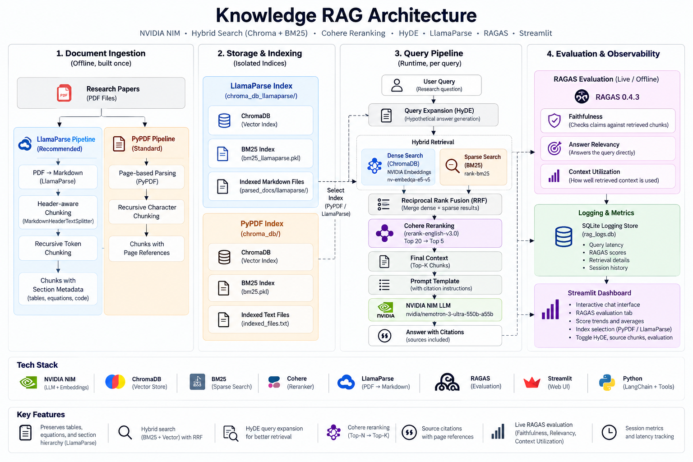

# Knowledge RAG

A fast, accurate RAG system for querying AI and machine learning research papers using NVIDIA NIM models, hybrid search (Chroma + BM25), Cohere reranking, HyDE expansion, LlamaParse markdown indexing, and live RAGAS evaluation.

---

## Problem
Reading and synthesizing machine learning research papers takes hours of tedious effort. When you turn to typical AI chatbots for quick answers, they often scramble complex tables, miss key math formulas, or confidently invent facts you have to double-check anyway. You end up having to read the whole paper manually because you simply cannot trust whether the AI is telling the truth.

## Solution
I built Knowledge RAG to create a research partner you can actually trust. It preserves the original structure of papers so tables and equations don't get lost, uses a blend of keyword and semantic search to pull the exact right passages, and grades its own answers on the fly—showing you live scores for accuracy and grounding so you never have to second-guess the findings.

## Current Bottlenecks & Areas to Improve
No system is perfect, and here are the honest trade-offs and areas currently being worked on:

1. **Live Evaluation Delay:** Running real-time grading with RAGAS on every single question adds about 5–8 seconds of waiting time, because an evaluator AI has to carefully inspect the answer before it finishes.
2. **Connecting Dots Across Multiple Papers:** The system is great at finding facts inside specific papers, but answering complex questions that require piecing together clues scattered across several different papers at once can still challenge a single search pass.
3. **Scaling Beyond Dozens of Papers:** Keyword search indices are currently stored as local files (`.pkl`), which runs blazing fast for tens of papers, but will need a dedicated search database once the library grows into thousands of documents.
4. **Initial Processing Time:** Converting heavy PDFs into clean markdown via LlamaParse preserves tables and math beautifully, but the initial conversion takes noticeable time and relies on an external API.

---

## Key Highlights

- **Dual Ingestion Pipelines**:
  - **LlamaParse Pipeline**: Converts PDFs into Markdown to preserve complex tables, equations, and code. Employs `MarkdownHeaderTextSplitter` + recursive token chunking.
  - **PyPDF Pipeline**: Fast, page-based parsing with recursive character splitting.
- **Isolated Vector & Sparse Indices**:
  - PyPDF index stored in `chroma_db/` & `bm25.pkl`.
  - LlamaParse index stored in `chroma_db_llamaparse/` & `bm25_llamaparse.pkl`.
  - Seamless index switching directly from the Streamlit sidebar.
- **Advanced Retrieval & Reranking**:
  - **HyDE**: Expands queries by generating hypothetical zero-shot answers before retrieval.
  - **Hybrid Search**: Fuses dense semantic search (ChromaDB) with sparse keyword matching (BM25).
  - **RRF & Cohere Rerank**: Merges scores via Reciprocal Rank Fusion ($k=60$) and reranks top 20 candidates down to top 5.
- **Live & Offline RAGAS 0.4.3 Evaluation**:
  - Evaluates each query live on Faithfulness, Answer Relevancy, and Context Utilization.
  - Built-in Streamlit dashboard tracking session averages, trend charts, and latency logs.
  - Standalone 20-question benchmark runner (`eval_workflow/run_baseline_eval.py`).

---

## Architecture & Pipeline



---

## Tech Stack

| Component | Tool / Model |
| :--- | :--- |
| **LLM** | NVIDIA NIM (`nvidia/nemotron-3-ultra-550b-a55b`) |
| **Embeddings** | NVIDIA NIM (`nvidia/llama-nemotron-embed-vl-1b-v2`) |
| **Vector DB** | ChromaDB (`chroma_db/` & `chroma_db_llamaparse/`) |
| **Sparse Search** | BM25 (`rank-bm25`) |
| **Reranker** | Cohere (`rerank-english-v3.0`) |
| **Query Expansion**| HyDE |
| **PDF Parser** | LlamaParse (Markdown result) & PyPDF |
| **Evaluation** | RAGAS 0.4.3 (Faithfulness, Relevancy, Context Utilization) |
| **UI** | Streamlit |

---

## Project Structure

```
RAG/
├── src/
│   ├── config.py                 # Paths, models, chunk sizes, and API config
│   ├── ingestion.py              # PyPDF loading, chunking, and Chroma/BM25 indexing
│   ├── markdown_ingestion.py     # LlamaParse markdown loading, header chunking, and indexing
│   ├── llamaparse_ingestion.py   # LlamaParse PDF-to-Markdown parser script
│   ├── retrieval.py              # Hybrid search, RRF merging, Cohere reranking
│   ├── hyde.py                   # Hypothetical Document Embeddings (HyDE) expansion
│   ├── generation.py             # Grounded prompt template, LLM generation, source citation
│   └── eval_ragas.py             # RAGAS 0.4.3 evaluation logic
├── eval_workflow/
│   └── run_baseline_eval.py      # Automated 20-question benchmark evaluation script
├── docs/                         # Raw PDF documents
├── parsed_docs/llamaparse/       # Converted markdown files
├── chroma_db/                    # PyPDF Chroma database
├── chroma_db_llamaparse/         # LlamaParse Chroma database
├── bm25.pkl                      # PyPDF BM25 index
├── bm25_llamaparse.pkl           # LlamaParse BM25 index
├── parse_all_pdfs.py             # CLI script to parse all PDFs to markdown via LlamaParse
├── index_llamaparse.py           # CLI script to batch-index markdown documents
├── app.py                         # Streamlit chat interface & evaluation dashboard
├── Dockerfile                    # Container configuration (Python 3.12-slim)
├── .dockerignore                 # Excludes venv, caches, and secrets from image
├── requirements.txt              # Python dependencies
└── .env                          # API keys
```

---

## Setup & Installation

### 1. Clone & Virtual Environment Setup
```bash
python -m venv venv

# Windows:
.\venv\Scripts\activate

# Mac/Linux:
source venv/bin/activate

pip install -r requirements.txt
```

### 2. Configure Environment Variables
Create a `.env` file in the root folder:
```env
NVIDIA_API_KEY=your_nvidia_api_key_here
COHERE_API_KEY=your_cohere_api_key_here
LLAMA_CLOUD_API_KEY=your_llama_cloud_api_key_here
```

---

## Usage

### 1. Ingestion Workflows
- **LlamaParse Markdown Mode** (Recommended):
  ```bash
  python parse_all_pdfs.py       # Convert docs/*.pdf to parsed_docs/llamaparse/*.md
  python index_llamaparse.py     # Index markdown chunks into chroma_db_llamaparse
  ```
- **PyPDF Standard Mode**:
  - Upload PDFs in the sidebar and click **Index New PDFs**.

### 2. Run the Web App (Locally)
```bash
streamlit run app.py
```
- Switch between **LlamaParse** and **PyPDF** collections in the sidebar.
- Toggle **HyDE**, **Source Chunks**, and **Live RAGAS evaluation** on demand.
- View real-time scores and aggregate trends under the **RAGAS Evaluation** tab.

### 3. Run with Docker (Alternative)
Run the entire application in an isolated container without installing Python dependencies locally:

1. **Build the image:**
   ```bash
   docker build -t knowledgerag .
   ```

2. **Run the container (passing your `.env` file):**
   ```bash
   # Default port 8501:
   docker run -p 8501:8501 --env-file .env knowledgerag

   # Or map to a custom port (e.g., 8080):
   docker run -p 8080:8501 --env-file .env knowledgerag
   ```

3. **Access the application:**
   Open `http://localhost:8501` (or `http://localhost:8080`) in your browser.

### 4. Run Benchmark Evaluation
```bash
python eval_workflow/run_baseline_eval.py
```

---

## Evaluation Metrics (RAGAS 0.4.3)

- **Faithfulness**: Verifies zero hallucinations by checking claims against retrieved chunks.
- **Answer Relevancy**: Ensures response directly answers the user query.
- **Context Utilization**: Quantifies precision of retrieved context in the final answer.

Check aggregate statistics and trends anytime under the **RAGAS Evaluation** tab.